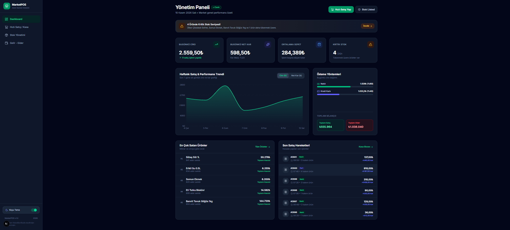
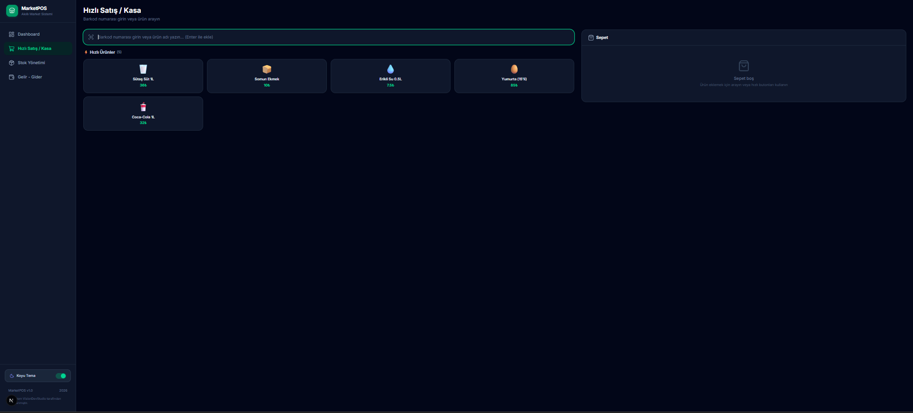
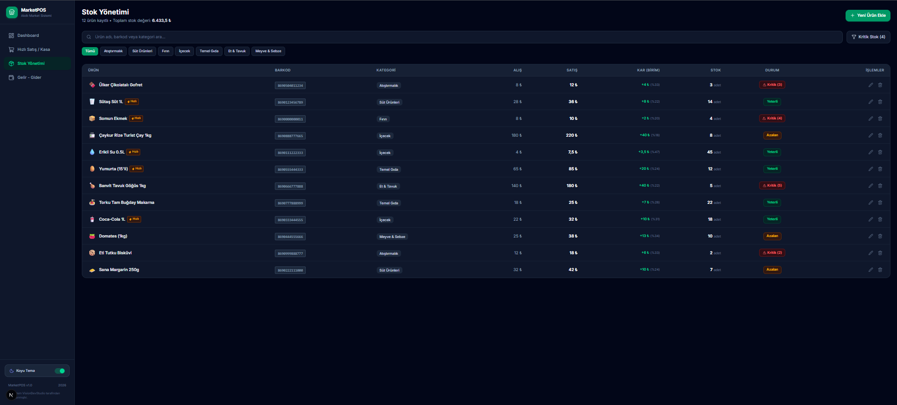
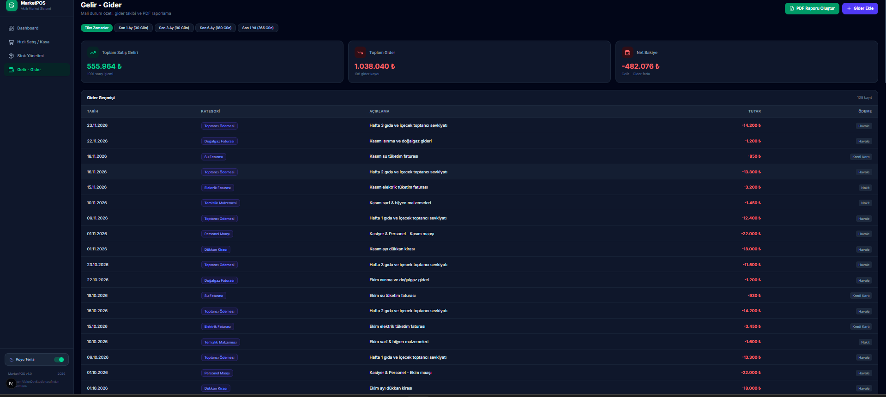
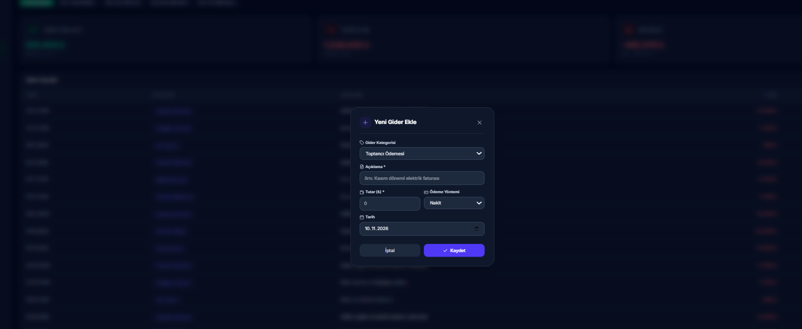
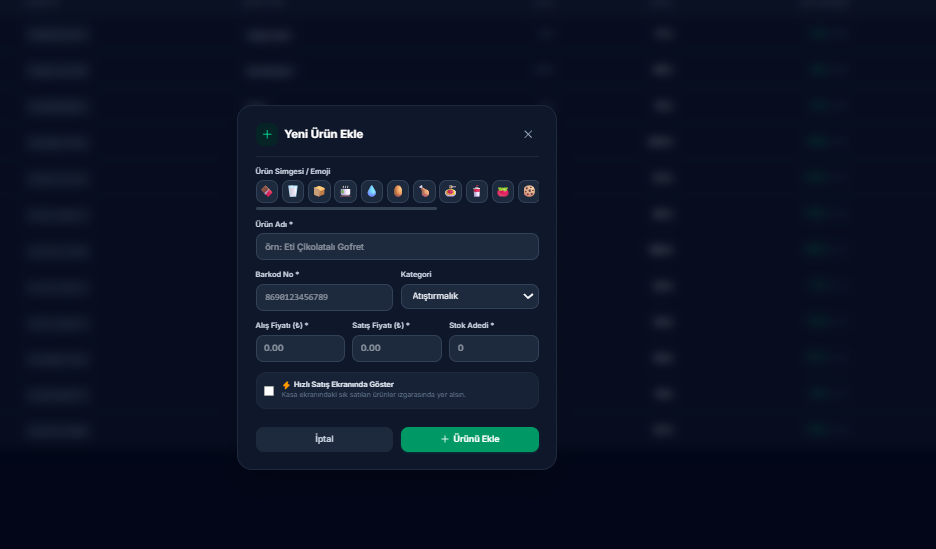

# MarketPOS

MarketPOS; küçük market ve bakkal işletmeleri için hazırlanmış, tarayıcıda çalışan modern bir satış noktası (POS), stok ve finans takibi demosudur. Uygulama Türkçe arayüz, mobil uyumlu tasarım ve açık/koyu tema desteği sunar.

> Bu proje bir demodur. Veriler tarayıcının yerel depolama alanında tutulur; sunucu, kullanıcı hesabı veya gerçek ödeme altyapısı içermez.

## Özellikler

- **Yönetim paneli:** Günlük ciro, net kâr, ortalama sepet, kritik stok uyarıları, son işlemler ve 7 günlük performans grafiği.
- **Hızlı satış / kasa:** Ürün veya barkod arama, hızlı ürünler, sepet yönetimi, nakit ya da kartla satış tamamlama.
- **Stok yönetimi:** Ürün ekleme, düzenleme ve silme; kategori, maliyet, satış fiyatı, barkod, stok ve hızlı erişim bilgileri.
- **Gelir–gider takibi:** Gider kaydı, ödeme yöntemi takibi ve mali özetler.
- **Finansal raporlama:** Son 1, 3, 6 veya 12 aya göre hesaplanan, yazdırılabilir PDF finansal raporu.
- **Kalıcı tarayıcı verisi:** Ürünler, satışlar, giderler ve tema tercihi `localStorage` içinde saklanır.
- **Duyarlı arayüz:** Masaüstünde yan menü, mobilde üst ve alt gezinme kullanır.

## Teknolojiler

- [Next.js 16](https://nextjs.org/)
- React 19 ve TypeScript
- Tailwind CSS 4
- Recharts
- Lucide React

## Gereksinimler

- Node.js 20.9 veya üzeri
- npm 10 veya üzeri

## Kurulum

```bash
git clone <depo-adresi>
cd market-demo
npm install
```

Geliştirme sunucusunu başlatın:

```bash
npm run dev
```

Ardından uygulamayı [http://localhost:3000](http://localhost:3000) adresinde açın.

## Komutlar

| Komut | Açıklama |
| --- | --- |
| `npm run dev` | Geliştirme sunucusunu başlatır. |
| `npm run build` | Üretim derlemesi oluşturur. |
| `npm run start` | Üretim derlemesini çalıştırır. |
| `npm run lint` | ESLint denetimini çalıştırır. |

## Mobil uygulama (PWA)

MarketPOS, Android ve iOS cihazlara ana ekrandan açılan bir **Progressive Web App (PWA)** olarak kurulabilir. PWA, APK/IPA dosyası veya uygulama mağazası yayını gerektirmez; uygulama doğrudan tarayıcıdan yüklenir ve bağımsız bir uygulama penceresinde açılır.

- **Android:** Chrome veya Edge menüsünden **Uygulamayı yükle** ya da **Ana ekrana ekle** seçeneğini kullanın.
- **iPhone / iPad:** Uygulamayı Safari’de açın, **Paylaş** düğmesine dokunun ve **Ana Ekrana Ekle** seçeneğini kullanın.
- Kurulumun çalışması için uygulama bir HTTPS alan adında yayınlanmalıdır. `localhost` geliştirme ortamı bunun istisnasıdır.
- Uygulama açıldıktan sonra ziyaret edilen ekranlar ve statik varlıklar çevrimdışı kullanım için önbelleğe alınır. İşletme verileri cihazın kendi `localStorage` alanında kalır.

## Kullanım

1. **Stok Yönetimi** bölümünden ürünleri görüntüleyin veya yeni ürün ekleyin.
2. **Hızlı Satış / Kasa** ekranında ürün arayın ya da hızlı ürünlerden sepete ekleyin.
3. Ödemeyi **Nakit** veya **Kredi Kartı** olarak tamamlayın. Satış stoktan otomatik düşer.
4. **Gelir - Gider** bölümünden işletme giderlerini kaydedin ve dönemsel raporu yazdırın ya da PDF olarak kaydedin.

## Veri saklama ve sıfırlama

Uygulama başlangıç için örnek ürün, gider ve satış verileri oluşturur. Sonraki değişiklikler yalnızca kullandığınız tarayıcının `localStorage` alanında saklanır. Bu nedenle farklı tarayıcılar veya cihazlar arasında senkronizasyon yapılmaz.

Demo verilerine dönmek için tarayıcı geliştirici araçlarından bu alan adının yerel verilerini temizleyin. Temizlenirken aşağıdaki anahtarlar kaldırılır:

- `market-data-version`
- `market-products`
- `market-sales`
- `market-expenses`
- `market-theme`

## Ekran Görüntüleri

### Yönetim paneli



### Hızlı satış / kasa



### Stok yönetimi



### Gelir - gider



### Gider ekleme



### Ürün ekleme



## Proje yapısı

```text
src/
├── app/
│   ├── page.tsx              # Yönetim paneli
│   ├── kasa/page.tsx         # Satış ve sepet ekranı
│   ├── stok/page.tsx         # Stok yönetimi
│   └── gelir-gider/page.tsx  # Giderler ve raporlama
├── components/               # Yan menü ve bildirim bileşenleri
└── lib/
    ├── mockData.ts           # Başlangıç/demo verileri
    ├── store.tsx             # Uygulama durumu ve localStorage işlemleri
    └── pdfReport.ts          # Finansal rapor hesaplama/yazdırma
```

## Notlar

- PDF raporu, yeni açılan yazdırma penceresi üzerinden oluşturulur. Tarayıcınız açılır pencereyi engelliyorsa izin vermeniz gerekir.
- Gerçek kullanım için bir kimlik doğrulama, sunucu taraflı veritabanı, yetkilendirme ve ödeme entegrasyonu eklenmelidir.
